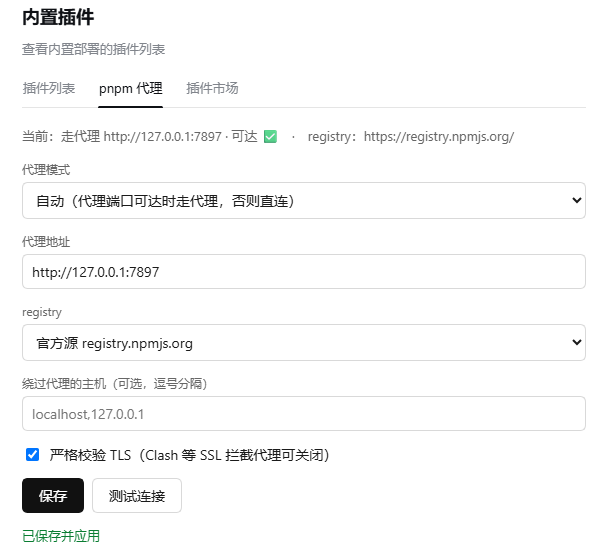

# dsh-pnpm-manager

Control whether the **pnpm** used by **DeepSeek Harness (DSH)** goes through a proxy — and inspect / switch its registry and store — from either DSH's settings page or a standalone CLI.



## Install

Use the bundled `dsh` CLI. Replace `<profile>` with your profile name (`desktop` for the app, `web` for `dsh web`, …).

```bash
# 1) git source (main channel)
dsh plugin --profile <profile> add "github:easyzoom/dsh-pnpm-manager#main"

# 2) npm (once published to npm)
dsh plugin --profile <profile> add dsh-pnpm-manager

# 3) local dev (a checkout of this repo)
dsh plugin --profile <profile> add /path/to/dsh-pnpm-manager
```

Notes:
- The **desktop profile is locked by the running app** — close DeepSeek Harness before a CLI install, or install from the app's Plugins panel.
- The git source works for a private repo too when your git credentials are set; a public repo needs no auth.
- The npm command requires the package to be published (`npm publish`) first.

## Why

Node and pnpm do **not** use the Windows system proxy, so pnpm connects to `registry.npmjs.org` and GitHub directly. Behind a firewall that is slow or fails with `ECONNRESET`. Pointing pnpm at a local proxy (e.g. Clash on `127.0.0.1:7897`) makes dependency resolution several times faster — but if the proxy is down, installs fail. This tool makes that switch one click (or one command) away.

## What it touches

Only the `proxy`, `https-proxy` and `registry` lines of `~/.npmrc`. Every other setting is preserved. A backup (`*.bak-<timestamp>`) is written only when the content actually changes.

## As a DSH plugin

`package.json` declares `dsh.bundle.patch`, and `cordis.patch.yml` inserts one host row. The row's `Config` (schemastery) is rendered by DSH as the plugin's settings form:

| field | values | meaning |
|-------|--------|---------|
| `mode` | `on` / `off` / `auto` | force proxy on / force direct / enable only when the proxy port is reachable |
| `proxyUrl` | URL | proxy address (default `http://127.0.0.1:7897`) |
| `noProxy` | hosts (comma-separated) | hosts that bypass the proxy (`noproxy`; only while the proxy is on) |
| `strictSsl` | `true` / `false` | strict TLS verification; disable it for SSL-intercepting proxies (e.g. Clash) → `strict-ssl=false` |
| `registry` | `keep` / `npmjs` / `npmmirror` | leave registry alone / official source / China mirror |

Editing the form rewrites `~/.npmrc` immediately (the loader re-applies the row).

> **Status:** verified in live DSH (isolated web profile **and** the desktop app): the host routes return live data; the card renders on the plugin's page **and** as a **pnpm 代理** tab under **Settings → Built-in plugins**, showing the mode status plus **开 / 关 / 自动 / 测试**. Host routes are also unit-tested.

### Client card (optional)

`lib/client.js` registers an editable form — mode, proxy URL, registry, no-proxy hosts, and strict-TLS — with a **save confirmation** (edit → 保存 → 确认保存) and a **测试连接** button, into both the plugin's page (`plugins.bundle.config` / family seat) and a **Settings → Built-in plugins** tab (`settings.plugins.tab`). Registration is guarded and waits for the seat to be declared, so an unavailable seat never breaks the Web boot.

## CLI

```bash
node bin/dsh-pnpm-manager.mjs status [--json]
node bin/dsh-pnpm-manager.mjs doctor [--json]
node bin/dsh-pnpm-manager.mjs on | off | toggle | auto
node bin/dsh-pnpm-manager.mjs proxy http://127.0.0.1:7890   # or: proxy reset
node bin/dsh-pnpm-manager.mjs registry npmjs | npmmirror
node bin/dsh-pnpm-manager.mjs store
node bin/dsh-pnpm-manager.mjs test
```

Environment: `PNPM_PROXY_URL`, `DSH_PROFILE_DIR`, `DSH_PNPM_CJS`.

## Layout

```
lib/index.js            host plugin (name / Config / apply + web routes)
lib/npmrc.js            shared .npmrc read/write helpers
lib/client.js           optional client card (__ModuleLoader__ bundle)
bin/dsh-pnpm-manager.mjs   standalone CLI
cordis.patch.yml        bundle patch (inserts the host row)
```

## License

MIT
